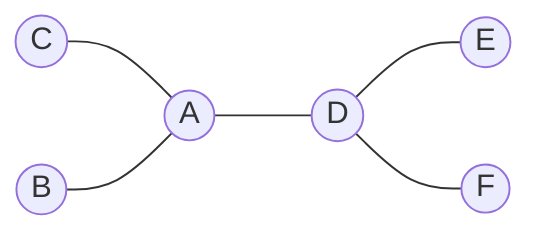
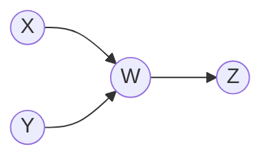
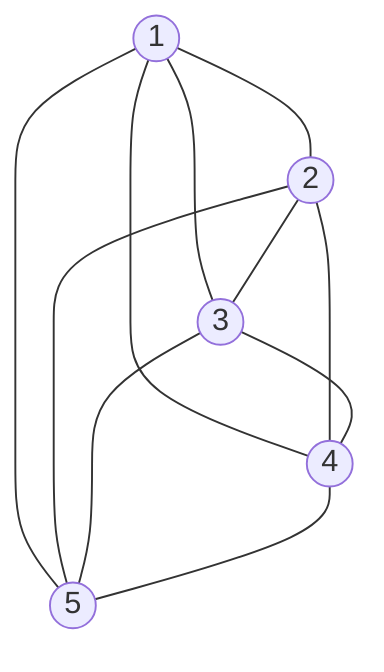
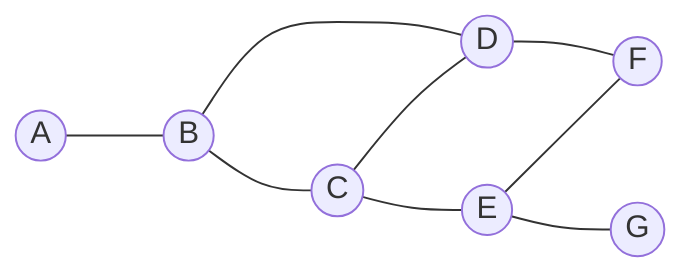

[[Tree]][[Suffix array]][[Disjoint set]][[learning/DS/Data stucture/Basic Data Strucutre/Stack and Queue|Stack and Queue]]

# Graph Terms and Definitions

## 1. Basic Components
A **Graph** \(G\) consists of two sets, written as \(G = (V, E)\):
*   **Vertices (\(V\))**: A non-empty set of nodes (represents a *position* or *state*).
*   **Edges (\(E\))**: A set of connections between vertices (represents a *transaction* or *relationship*).

## 2. Degree
The **Degree** of a vertex is the number of edges connecting to it.

> [!info] Directed Graphs (DiGraph)
> For directed graphs, degree is split into two:
> *   **In-degree**: Number of edges pointing *to* the vertex.
> *   **Out-degree**: Number of edges pointing *out* the vertex.

### Visual Example: Degree

A have a degree 3



Node **W** has an **in-degree of 2** (X, Y) and an **out-degree of 1** (Z)

## 3. Weights

- **Unweighted Graph**: No values are associated with edges (e.g., _Can a bus go from point A to B? Yes/No_).
    
- **Weighted Graph**: A numerical value is associated with each edge (e.g., _Bus fee from A to B is $10_).
    

> [!note] Directed Graph Weights  
> In a directed graph, the weight from A→BA→B can be different from B→A,B→A.

## 4. Graph Types

### Simple Graph

A simple graph is an **unweighted, undirected** graph that contains:

- **No graph loops** (an edge connecting a vertex to itself).
    
- **No multiple edges** (more than one edge connecting the same two vertices).
    

### Complete Graph

A **simple graph** in which **every pair of distinct vertices is connected by a unique edge**.

- **Formula for Edges:** If the number of vertices ∣V∣=n∣V∣=n, then the number of edges is:
    

$$\frac{n(n-1)}{2} $$ 



---
# Representations of graph

## Adjacency Matrix

## 1. What is it?
An **Adjacency Matrix** is a 2D array (a matrix) used to represent a graph.
*   **Size:** It is an \(N $\times$ N\) matrix where \(N\) is the number of vertices.
*   **Values:** The cell at `matrix[i][j]` represents the connection or weight between vertex \(i\) and vertex \(j\).
    *   **Unweighted graphs:** Uses `1` (True) or `0` (False) to indicate if an edge exists.
    *   **Weighted graphs:** Stores the actual weight (cost/distance) in the cell.

## 2. Example: Undirected Graph


$$
\begin{array}{c|ccccccc}
 & A & B & C & D & E & F & G \\ \hline
A & 0 & 1 & 0 & 0 & 0 & 0 & 0 \\
B & 1 & 0 & 1 & 1 & 0 & 0 & 0 \\
C & 0 & 1 & 0 & 1 & 1 & 0 & 0 \\
D & 0 & 1 & 1 & 0 & 0 & 1 & 0 \\
E & 0 & 0 & 1 & 0 & 0 & 1 & 1 \\
F & 0 & 0 & 0 & 1 & 1 & 0 & 0 \\
G & 0 & 0 & 0 & 0 & 1 & 0 & 0 
\end{array}
$$

> [!success] Advantages
> 
> - **Fast Query**: Checking if an edge exists (or finding its weight) between two specific vertices takes **O(1)** time. Just look up `matrix[u][v]`.
>     

> [!danger] Disadvantages
> 
> - **Memory Waste (Space Complexity O($N^2$))**:
>     
>     - It always uses $N^2$ space, regardless of how many edges there actually are.
>         
>     - If you have 10,000 vertices (10K10K), you need a 10,000×10,00010,000×10,000 grid 
>         
> - **Wasteful for Sparse Graphs**:  the matrix will be filled mostly with `0`s.
>     
> - **Slow to find neighbors**: find all vertices connected to vertex AA , must scan the entire row for AA in $N^2$ time. 

---

## Adjacency List

-> use link list to store neighboring vertex

```txt
Adjacency Matrix
----------------
edge query: FAST
memory: O(V²)
good for dense graph


Adjacency List
--------------
neighbor traversal: FAST
memory: roughly O(V + E)
good for sparse graph
```

>[!success] Advantages
>- **save memory**: if sparse graph
>- **Fast Query** : Enumeration of all neighbors are fast

>[!danger] Disadvantages
>- **Slow update** : maintain the order
>- **Connection are slow** : query on the edge weight


---
## Compressed Sparse Row (CSR)

CSR is an efficient way to store **sparse matrices or graphs**. CSR compresses the data into two 1D arrays to save memory.

CSR uses two main arrays to represent the graph:

1.  **`edge-array` (Targets only)**:
    *   Lists all the destinations (targets) of the edges.
    *   The edges are **sorted by their source vertex**.
    *   It does *not* store the source vertex, because the `vertex-array` handles that.

2.  **`vertex-array` (Offsets)**:
    *   Stores the starting **index (offset)** in the `edge-array` for each vertex.
    *   It tells you exactly where the outgoing edges for a specific vertex begin and end.
    *   *(Note: It usually has a length of \(N+1\), where the last element is the total number of edges).*


Given this Adjacency Matrix:
$$
A = \begin{bmatrix}
1 & 1 & 0 & 0 \\
0 & 1 & 1 & 0 \\
1 & 0 & 1 & 1 \\
0 & 1 & 0 & 1
\end{bmatrix}
$$

compress it into:

*   **Edge ID**: `0  1  2  3  4  5  6  7  8`
*   **`edge-array`** = `[0, 1, 1, 2, 0, 2, 3, 1, 3]`
*   **`vertex-array`** = `[0, 2, 4, 7, 9]`

### Step-by-Step
*   **Vertex 0**: Starts at index `0`, ends before index `2`. The targets are `edge-array[0]` and `edge-array[1]` $\rightarrow$**`[0, 1]`**.
*   **Vertex 1**: Starts at index `2`, ends before index `4`. The targets are `edge-array[2]` and `edge-array[3]` $\rightarrow$**`[1, 2]`**.
*   **Vertex 2**: Starts at index `4`, ends before index `7`. The targets are `edge-array[4]`, `[5]`, and `[6]` $\rightarrow$ **`[0, 2, 3]`**.
*   **Vertex 3**: Starts at index `7`, ends before index `9`. The targets are `edge-array[7]` and `[8]` $\rightarrow$ **`[1, 3]`**.

> [!success] Why use it?
> *   **Memory Efficient**: It only stores non-zero elements. Perfect for sparse graphs where \(Edges $N^2$\).
> *   **Fast Neighbor Access**: You can find all outgoing edges of vertex \(u\) very quickly by looking up `vertex-array[u]` to `vertex-array[u+1]`.
> *

```txt
transfer adjacenct list into CSR

0: 1, 2
1: 0
2: 0, 3
3: 2

Edge = [1, 2, 0, 0, 3, 2]
        0  1  2  3  4  5   ← index

根据每个vertex有几个，比如vertex 0，1,2 edges ,which start from the array index 0 , 所以[0]
慢慢往下加，加到vertex 3 ， 会发现是5，补个6 当结束

```
Edge Array   = WHO are my neighbors?
Vertex Array = WHERE does my neighbor list start?

---
# DFS 

深度优先搜索
```txt
DFS = explore one road completely
      before trying another road


```

```c++
DFS(v){
	visited[v] =true;
	for each vertex w adjacent to v;
	if(!visited[w]);
		DFS(W);
}
```


1. 我来到了节点 `v`，先在花名册上把 `v` 打个勾（`visited[v] = true`），证明我来过了。
    
2. 然后我看一下 `v` 都连着哪些邻居 `w`。
    
3. 如果发现某个邻居 `w` 还没打过勾，我就立刻动身前往 `w`（`DFS(w)`）。
    
4. **注意：** 一旦我去了 `w`，我就会在 `w` 那里重复上面的步骤，直到把 `w` 能走到的路全走完，我才会退回到 `v`，接着找 `v` 的下一个邻居。这就是“递归”**和**“深度优先”**的体现。


```c++
DFS_Iterative(v) {
    // 1. 初始化：将起点入栈
    Stack S;            // 声明一个空栈
    Push(S, v);         
    
    // 2. 当栈不为空时，循环执行
    While (not IsEmpty(S)) {
        // 3. 弹出栈顶元素
        x = Pop(S);     
        
        // 4. 如果 x 还没被访问过
        if (!visited[x]) {
            visited[x] = true;      // 标记 x 已访问
            Print/Process(x);       // 处理节点 x (如打印或记录结果)
            
            // 5. 寻找 x 的所有邻接点 w
            for each vertex w adjacent to x {
                // 6. 如果邻接点 w 还没被访问，则入栈
                if (!visited[w]) {
                    Push(S, w); 
                }
            }
        }
    }
}
```
- 
    A入栈，出栈，标记A。_
    
- _发现邻居B和C都没访问，B入栈，C入栈。栈：[B, C]。_
    
- _C出栈，标记C。_
    
- _C发现邻居B没访问，B再次入栈。栈：[B, B]。_  
    **结论：** 如果一个节点有多个未访问的邻居，它可能会被多次压入栈。所以必须在**出栈时**才判断 `if (!visited[x])`，以此过滤掉重复入栈的节点。


# BFS

广度优先搜索
```txt
	Visit everything close to me first, then go one level farther.
```

```C++
bfs(v){
	visited[v] = true;
	enqueue(v);
	while queue is not empty{
		x=dequeue();
		for each vertex w adjacent to x{
			if(!visited[w]){
				enqueue(w);
				visited[w]=ture;
			}
		}
	}
}
```

1. 起点 `v` 进队列，打勾。
    
2. **只要队列里有人，就循环以下动作：**
    
3. 让排在最前面的人出队（`x = dequeue()`）。
    
4. 问 `x`：“你的邻居都有谁？”。
    
5. 把 `x` 没打过勾的邻居 `w` 全部叫过来，排到队伍的最后面（`enqueue(w)`），并且**马上给他们打勾**（`visited[w] = true`）。_(注意：这里是在入队时就打勾，而 DFS 是在真正访问时才打勾，这是为了防止同一个邻居被多个节点重复拉进队列)_。
    
6. 等这批邻居在队列后面排好队了，循环继续，从队列里叫下一个人出队，去查他的邻居。


```txt
DFS
→ deep
→ stack / recursion

BFS
→ broad / level by level
→ queue
```

---
# Spanning tree 生成树

A **spanning tree** of a connected graph must:

- include **all vertices**
- use only edges from the original graph
- contain **no cycle**
- have exactly `|V| - 1` edges.

## Minimum spanning tree

- edges are weighted -> lowest cost first
### Cycle Property
*   **基础前提**：一棵生成树 \(T\) 加上一条新边 $e_{new}$，必定会形成一个**环**。
*   **关键**：
    *   如果在环里随便删掉一条旧边 $e_{old}$，它又会变回一棵正常的树。
    *   **进阶**：如果加进来的新边比删掉的旧边**权重更小**$e_{new} < e_{old}$，那我们就把总成本降低了，**血赚！**

---
## Construction Strategy
> **贪心算法 (Greedy Algorithm) 的核心法则：**

*   **怎么建树？**
    *   **无脑选最小的**：每次挑一条当前**代价最小**的边。
    *   **不搞闭环**：加入这条边**绝不能**形成环（形成环就废弃它）。
    *   **搞满为止**：重复上述步骤，直到加了 **$|V| - 1$** 条边（$|V|$) 是顶点数，树就是顶点数-1条边）。

## Prim Algorithms

### 核心思想

- **像滚雪球一样建树**：从某一个起点开始，一步步向周围**扩展**（Incrementally / Expand）。
    
### 贪心策略

1. **找边**：在“已经在树里的节点”和“还没进树的节点”之间，找一条**代价最小（lower cost）** 的边。
    
2. **防环**：确保这条新边**不会形成环**（因为是连接到树外的节点，天然防环）。
    
3. **合并**：把这条边和对应的新节点拉进树里，扩大树的版图。

### Implementation

- **数据结构**：使用**邻接表** (Adjacency List) 存图。
    
- **核心数组**：
    
    - `cost[]`：记录节点连接到当前树的**最小代价**（初始全为无穷大 `INF`）。
        
    - `prev[]`：记录节点的**父节点**（用来最后还原树的形状）。
        
    - `marked[]`：标记节点是否已经**加入树中**。
        
1. **起点**：随便挑个起点 `v`，代价设为 `0`，父节点设为 `-1`。
    
2. **循环找**：在所有**还没进树（unmarked）**的节点里，挑一个**代价最小**的节点 `u`。
    
3. **入树**：把 `u` 标记为已进树（`mark it`）。
    
4. **更新邻居**：遍历 `u` 的所有邻居 `w`。如果发现从 `u` 到 `w` 的边，比 `w` 之前记录的代价还要小，就**更新 `w` 的代价**，并把 `w` 的父节点设为 `u`。
    

如果每次找“最小代价节点”用的是**二叉堆 (优先队列)**，时间复杂度就是 **`O((n+m)log n)`** （`n`是点数，`m`是边数）。

```txt
初始化：
  所有节点的 cost = 无穷大(INF)
  所有节点的 marked = false
  选定起点 start：cost[start] = 0, prev[start] = -1

当还有节点没被标记(marked == false)时，循环：
  1. 在所有没标记的节点里，找到 cost 最小的那个，叫它 u
  2. 把 u 标记为已访问 (marked[u] = true)
  
  3. 遍历 u 的所有邻居 w (且 w 还没被标记)：
       如果 边(u, w)的权重 < cost[w]：
           cost[w] = 边(u, w)的权重
           prev[w] = u  // 记录 w 是连着 u 进树的
```

```cpp
#include <iostream>
#include <vector>
#include <queue>

using namespace std;

const int INF = 1e9; // 定义无穷大

// 定义边的结构体
struct Edge {
    int to;
    int weight;
};

// 优先队列的节点结构，按代价从小到大排序
struct Node {
    int id;
    int cost;
    bool operator>(const Node& other) const {
        return cost > other.cost; // 小根堆
    }
};

int prim(int n, vector<vector<Edge>>& graph) {
    vector<int> cost(n, INF);   // 记录到达每个节点的最小代价
    vector<int> prev(n, -1);    // 记录父节点
    vector<bool> marked(n, false); // 记录是否已加入生成树
    
    // 优先队列：存储 {节点编号, 当前代价}，自动按代价升序排列
    priority_queue<Node, vector<Node>, greater<Node>> pq;
    
    // 假设从节点 0 开始
    cost[0] = 0;
    pq.push({0, 0}); // 压入起点
    
    int totalCost = 0; // 最小生成树的总权重
    int edgeCount = 0; // 已加入的边数

    while (!pq.empty() && edgeCount < n) {
        // 1. 选出代价最小的节点 u
        Node current = pq.top();
        pq.pop();
        int u = current.id;
        
        // 如果这个节点已经被标记过了（因为优先队列里可能有重复的旧数据），直接跳过
        if (marked[u]) continue;
        
        // 2. 标记节点，加入生成树
        marked[u] = true;
        totalCost += cost[u]; // 累加总代价
        edgeCount++;
        
        // 3. 遍历邻居并更新代价
        for (const Edge& edge : graph[u]) {
            int w = edge.to;
            int weight = edge.weight;
            
            // 如果邻居没进树，且经过 u 到达 w 的代价更小
            if (!marked[w] && weight < cost[w]) {
                cost[w] = weight;     // 更新最小代价
                prev[w] = u;          // 记录父节点
                pq.push({w, cost[w]}); // 放入优先队列
            }
        }
    }
    
    // 如果 edgeCount < n，说明图不连通，无法构成生成树
    if (edgeCount < n) {
        cout << "图不连通！" << endl;
        return -1;
    }
    
    return totalCost;
}
```
