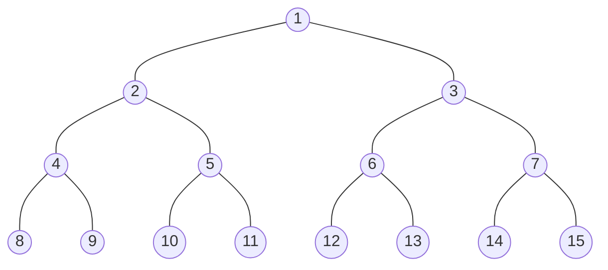
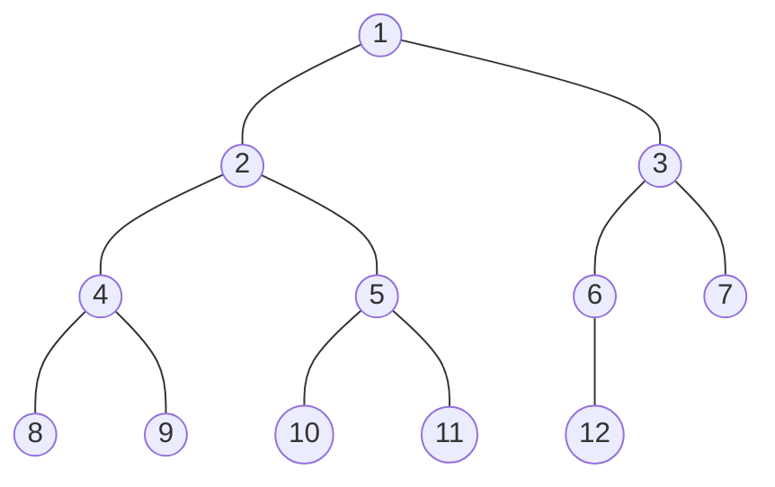
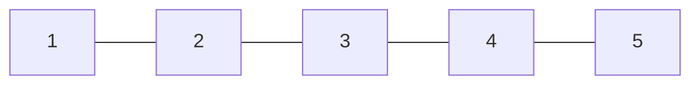
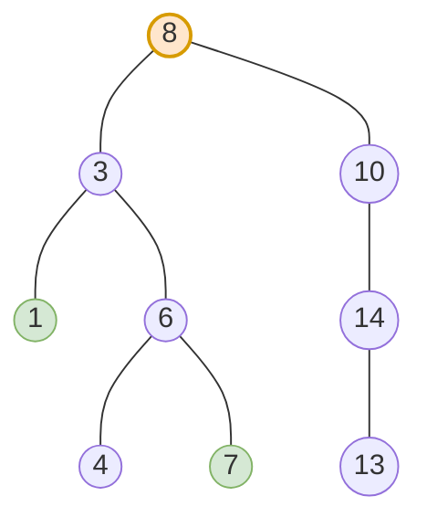

## What is it?
[[vector]]
[[learning/DS/Data stucture/Basic Data Strucutre/Stack and Queue|Stack and Queue]]
[[learning/DS/Data stucture/Basic Data Strucutre/Linked list|Linked list]]
Dynamic Data structure 

```text
          [ 数据 | 左地址 | 右地址 ]
              /            \
             /              \
    [数据|左|右]      [数据|左|右]
```

本质上是一个二维的链表

> **链表是一个“单细胞生物”（只会往前爬）。**  
> **树是一个“全身镜”（一个爹，最多俩儿子）。**
> 链表像一列火车（只能往前走），树像一个倒挂的树根（从根出发，分出左叉和右叉）。


**平衡二叉树** 是指该树所有节点的左右子树的高度相差不超过 1。

---
## Why should I use it 

1. **它是现实世界的映射**：电脑里的文件夹（目录树）、网页的 DOM 结构、公司组织架构，全是树。
    
2. **它是算法题的半壁江山**：LeetCode 上 30% 的题都跟树有关。
    
3. **它是递归思维的训练场**：学完树，你才真正理解什么叫“自己调用自己”。

---
## Method 

```cpp
struct TreeNode {
    int val;
    TreeNode *left;   // 指向左孩子（类似 next）
    TreeNode *right;  // 指向右孩子（又多了一个分叉）
    TreeNode(int x) : val(x), left(nullptr), right(nullptr) {}
};
```

根据“当前节点”处理顺序的不同，分为 3 种：

|遍历方式|顺序|一句话记忆|经典用途|
|---|---|---|---|
|**前序 (Pre-order)**|**根** -> 左 -> 右|先处理自己，再去管孩子|复制树、求深度（自上而下）|
|**中序 (In-order)**|左 -> **根** -> 右|先管左边，再处理自己，再管右边|**二叉搜索树（BST）专用，结果是升序**|
|**后序 (Post-order)**|左 -> 右 -> **根**|先让左右孩子算完，自己再汇总|**求树的高度、直径（最常用！）**|

---
## Compare（与链表的终极对比）

|特性|**Linked List (链表)**|**Tree (树)**|
|---|---|---|
|**指针数量**|1 个（`next`）|2 个（`left`, `right`）|
|**形状**|一条线|分叉的金字塔|
|**遍历方式**|`while` 循环（迭代）|**递归（绝大多数）** 或 `queue`|
|**是否有环**|可能有（判环）|无环（天然结构）|
|**复杂度难点**|反转、指针丢失|**递归深度、返回值理解**|
|**典型问题**|反转链表、合并|最大深度、路径总和、对称树|

---

## 树的高度
```cpp
int maxDepth(TreeNode* node) {
    // 1. 如果当前盒子是空的，别说高度了，你是 0
    if (node == nullptr) return 0;
    
    // 2. 去问左手边的兄弟，他有多高？
    int leftHeight = maxDepth(node->left);
    
    // 3. 去问右手边的兄弟，他有多高？
    int rightHeight = maxDepth(node->right);
    
    // 4. 取左右两边最大的，加上自己这一层（+1），报上去！
    return 1 + max(leftHeight, rightHeight);
}
```
**正常人的逻辑（也是程序的逻辑）：**

1. 你站在 `1` 号盒子那里。
    
2. 你揪住左边的 `2` 号盒子问：“喂，你下面有多高？”（递归）
    
3. 你揪住右边的 `3` 号盒子问：“喂，你下面有多高？”（递归）
    
4. `2` 号盒子说：“我下面没人了，我高 **1**。”
    
5. `3` 号盒子说：“我下面也没人，我也高 **1**。”
    
6. 你听完比较一下，发现都是 1，取最大的那个（还是 1），然后加上你自己这层（`1 + 1 = 2`）。

  
>树的后序遍历核心逻辑：不把左边彻底刨干净，绝对不去碰右边。 
---
## 树的前中后序遍历

> 假设当前节点为 **根 (Root)**，遍历顺序遵循 **左子树 (Left)** 永远在 **右子树 (Right)** 之前。

| 遍历方式                  | 访问顺序            | 记忆口诀    | 应用场景                                    |
| --------------------- | --------------- | ------- | --------------------------------------- |
| **前序遍历 (Pre-order)**  | **根** -> 左 -> 右 | **根**左右 | 复制树、序列化、文件目录结构打印                        |
| **中序遍历 (In-order)**   | 左 -> **根** -> 右 | 左**根**右 | **二叉搜索树 (BST)** 升序输出（有序序列）,一直递归左子树，然后回根 |
| **后序遍历 (Post-order)** | 左 -> 右 -> **根** | 左右**根** | 删除/释放树、计算目录大小（自底向上）                     |

---



# Definition

> n(n>=0) make a set 
> when n = 0 ,empty tree


* Degree : 有多少尿分叉
## Full binary tree


-> 节点数 $= 2^{h+1} - 1$
-> Full of node


## Completed binary tree




-> Except the bottom level: all are fully filled.
-> last bottom may not filled 


- using array : 
	 simpler
	 save storage


> during reconstruction
> 1. preorder + inorder
> 2. inorder + postorder

---
# Binary search tree



1. 探索每一个node的大小
2. 大放在右，小放左

## Deletion

> 找左子树最大的，或者找右子树最小的

```
Option 1: Inorder predecessor
= LARGEST value in LEFT subtree
= go LEFT once, then keep going RIGHT

Option 2: Inorder successor
= SMALLEST value in RIGHT subtree
= go RIGHT once, then keep going LEFT
```

---
# Application

## DFS , depth first search 深度优先搜索
>==🔴preorder traversal== go as deep as you can

## BFS , breadth first search 广度优先搜索
> FIFO queue ,go as breadth as you can

## Game tree ->Minmax

- root = initial game state
- each node = a possible game state
- each edge = one possible move
- each root-to-leaf path = one possible complete game

```txt
MAX node:
take maximum child

MIN node:
take minimum child
```

## α-β pruning
> Minmax->If a branch cannot possibly improve the decision, stop exploring it.
- **α (alpha)** at a MAX node = the best value MAX can already guarantee.
- **β (beta)** at a MIN node = the best value MIN can already guarantee.
- Prune when **α ≥ β**

```
1. explore left-to-right
2. update alpha or beta
3. check alpha >= beta
4. if true → prune remaining siblings
5. otherwise → keep exploring
```

| node type | can updated             | what time cut        |
| --------- | ----------------------- | -------------------- |
| max       | **α = max(**α,v),α = -∞ | v>= β**=> β**->cut   |
| min       | β** =min(β** ,v), p=+∞  | v<=**α => **α -> cut |
```txt
function MaxValue(node, α, β):
    if node is leaf:
        return utility(node)
    v = -∞
    for each child of node:
        v = max(v, MinValue(child, α, β))
        if v >= β:
            return v        // β cutoff
        α = max(α, v)
    return v

function MinValue(node, α, β):
    if node is leaf:
        return utility(node)
    v = +∞
    for each child of node:
        v = min(v, MaxValue(child, α, β))
        if v <= α:
            return v        // α cutoff
        β = min(β, v)
    return v
```

---
# AVL tree 
>|height(left subtree) - height(right subtree)| <= 1

```
1. Insert like a normal BST
2. Move upward from the new node
3. Find the first unbalanced ancestor
4. From that node, look at the first two directions toward the inserted node
5. Classify:
   LL / RR / LR / RL
6. Rotate
```

谁unbalance , 谁rotate ， 而不是下一个

## Types of rotation

### LL
```txt
      30
     /
    20
   /
  10
```

```c++
void rotateLL(Node & v)
{
	Node * x = v->lson;
	v->lson = x->rson;
	x->rson = v;
	v = x;
}
```
rotate right
### RR
```
    20 ← v
      \
       40 ← x
		\
	    50
```

```c++

void rotateRR(Node & v)
{
	Node * x = v->rson;
	v->rson = x->lson;
	x->lson = v;
	v = x;
}
```

rotate left
### LR
```txt
        40
       /
      20
        \
         30

```

>40->left - > right

```txt
1.rotate the right son , which rotate right
2.become a normal case
        40
       /
      30
     /
    20
3.rotate again ->right

        30
       /  \
      20   40
```

```
        40
       /
      30
     /
    20
```

### RL
```txt
20
  \
   50
  /
 40
```

```txt
1.rotate the left son , which rotate left
2.become a normal case
20
  \
   40
     \
      50
3.rotate again ->left
      40
     /  \
    20   50
```

```python

dbl_rotateL
    rotateR(left child)
    rotateL(root)
    变成LL


dbl_rotateR
    rotateL(right child)
    rotateR(root)
    变成一个RR
```

```c++
void AVL::insertR(Node*& t, item x)
{
    if (t == NULL) {
        t = new Node(x);
        return;
    }

    else if (x < t->data)
    {
        insertR(t->lson, x);

        if (h(t->lson) == h(t->rson) + 2)
        {
            if (x < t->lson->data)
                rotateL(t);       // LL
            else
                dbl_rotateL(t);   // LR
        }
    }

    else if (x > t->data)
    {
        insertR(t->rson, x);

        if (h(t->rson) == h(t->lson) + 2)
        {
            if (x > t->rson->data)
                rotateR(t);       // RR
            else
                dbl_rotateR(t);   // RL
        }
    }

    else ;   // duplicate

    t->height =
        max(h(t->lson), h(t->rson)) + 1; 
        //why at the last , height of the subtree need to learn that their subtree hegight change
}
```

```txt
insertR(t,x)

if empty:
    create node

else if x is smaller:
    insert into left subtree

    if left becomes too tall:
        if x went left-left:
            LL rotation
        else:
            LR rotation

else if x is larger:
    insert into right subtree

    if right becomes too tall:
        if x went right-right:
            RR rotation
        else:
            RL rotation

update height
```

```
          INSERT
            ↓
      travel downward
            ↓
       create new leaf
            ↓
      travel back upward
            ↓
       update heights
            ↓
       detect imbalance
            ↓
          rotate
            ↓
     fix affected heights
     所以是从下往上寻找
     
```

---
# Splay Tree

>has worst-case `O(n)` for one operation, but amortized `O(log n)` over a sequence of operations.

AVL:

```
rotate because tree became unbalanced
```

Splay:

```
rotate because we accessed this node
and want it at the root
```

## Case 1 node -already root

```txt
       30 ← n
      /  \
    ...
```
nothing do

## Case 2 - node is the child of the root - zig

```txt
child of root
→ one rotation
→ node becomes root
```

```txt
       30 ← parent/root
      /
    20 ← n
```

==🔴similar to RR AND LL in AVL tree , but LL change to RR==

```txt
   20
      \
	    30
```

## Case 3 - node have grandpa and parents and C(2), zigzig

```txt
       50 ← g
      /
    30 ← p
    /
   20 ← n
```

```txt
20
  \
   30
     \
      50
```

## Case 4 - node have grandpa and parent but RL , LR , zigzag

```txt
       50 ← g
      /
    20 ← p
      \
       30 ← n
```

```txt
20
  \
   50
   /
  30
```

| Position of accessed node | Splay case |
| ------------------------- | ---------- |
| already root              | nothing    |
| child of root             | Zig        |
| LL / RR grandchild        | Zig-Zig    |
| LR / RL grandchild        | Zig-Zag    |

# Insertion of splay tree -> splitting

1. Find x, or find the parent of where x should be.
2. Splay that node to the root.
3. Use the root's left/right parts to create L and R.

T $=L\bigcup R$ 
- all element in L are $\leq$ x
- all element in r are $\geq$ x
- $L \bigcap R = \phi$

```c++
void insert(Node*& root, Object x)
{
    Node* left;
    Node* right;

    split(root, left, right, x);

    root = new Node(x, left, right);
}
```

```txt
split old tree around x

        ↓

get:
left tree  = values < x
right tree = values > x

        ↓

create x as new root

        x
       / \
      L   R
```

```txt
        30
       /  \
     10    40
       \
        20
        
Split(T, 25)

L:                  R:

     10               30
       \                \
        20               40

10,20 < 25

30,40 > 25

          25
         /  \
        L    R

          25
         /  \
       10    30
         \     \
         20     40
```

# Delete of splay tree

```txt
1. Find(x)
2. Splay x to the root
3. Delete the root x
4. Now we have two trees:
   L = everything < x
   R = everything > x
5. Join(L, R)
	1. Splay the maximum element of L to the root
	2. Attach R as its right subtree
```

==🔴Find the **maximum element in L**, splay it to the root of L, then attach R as its right subtree.==
You can use minimum of R in a symmetric implementation, but your lecture defines Join using maximum of L.

```txt
        40
       /  \
     20    60
    / \    / \
   10 30  50 70
   
L:              R:

   20              60
  / \             / \
10  30           50 70

every value in L < every value in R

        30
       /  \
     20    60
    /     /  \
   10    50   70
```
