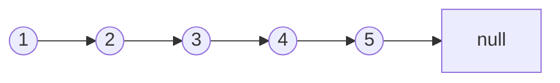

## What is it?
[[vector]]
[[learning/DS/Notes/Stack and Queue|Stack and Queue]]
Dynamic Data structure 

链表是一种**物理存储单元上非连续、非顺序**的线性数据结构。它由一系列节点（Node）组成。

- **核心组成**：每个节点包含 **数据域（Data）** 和 **指针域（Next）**。
    
    - 单向链表：节点只存 `next` 指针，指向下一个节点。
        
    - 双向链表（`std::list`）：节点存 `prev` 和 `next`，可以往前和往后走。
        
- **逻辑模型**：就像寻宝游戏，你手里只有第一张藏宝图（头节点 `head`），根据它找到下一个地点，再找下一个，直到找到 `nullptr`（宝藏尽头）。
    
- **底层实现**：节点在**堆（Heap）**上动态分配，内存地址不连续。




---
## Why should I use it 

| 场景               | **Vector（数组）**                 | **Linked List（链表）**             |
| ---------------- | ------------------------------ | ------------------------------- |
| **插入/删除（头部/中间）** | **O(n)**。要搬动后面的所有元素，数据量大时巨慢。   | **O(1)**。只需改改相邻节点的指针，数据纹丝不动。    |
| **插入/删除（尾部）**    | **O(1)**（均摊），很快。               | **O(n)**（单向链表）或 O(1)（双向链表带尾指针）。 |
| **随机访问（按下标取）**   | **O(1)**。直接算地址，极快。             | **O(n)**。只能从 `head` 一个个往下数。     |
| **内存连续性**        | **连续内存**。CPU 缓存友好，遍历极快。        | **碎片内存**。每个节点单独 new，缓存不友好。      |
| **扩容**           | 需要搬迁整个数组（Rehash / Reallocate）。 | 来一个新节点，随便找个内存角落挂上去即可。           |

> **结论（死记硬背）：**  
> **频繁在中间/头部插入删除 + 数据量大 + 不关心下标查询** → 用链表。  
> **频繁按下标查询 + 遍历 + 数据量小** → 用 `vector`。


---
## Method to create Linked list
```cpp
for (auto it = myList.begin(); it != myList.end(); ++it) {
        std::cout << *it << " "; // 输出 1 2 3
    }
    // 4. 在指定位置插入（O(1) 复杂度，前提是拿到迭代器）
    auto it = myList.begin();
    ++it; // 指向第二个元素
    myList.insert(it, 99); // 在第二个位置前插入 99
    
```
用这个办法可以遍历链表/增加，改链表
关键词 *`auto`* 

```cpp
void printList(ListNode* head) {
    ListNode* cur = head; // 用 cur 游标走，别动 head（不然找不到头了！）
	while(cur!=nullptr){
		cout<<val->cur;
		cur = cur->head;
		
	}
}

```
遍历输出
记得释放内存

```cpp
ListNode* reverseList(ListNode * head){
	ListNode *prev = nullptr;
	ListNode *cur =head;
	while(cur!=nullptr){
		ListNode* temp = cur->next;
		cur->next = pre ;
		pre = cur;
		cur = temp;
	}
	return prev
}
```

---
## Compare（总览对比）

| 特性            | **Vector**     | **List (链表)**           |
| ------------- | -------------- | ----------------------- |
| **随机访问 `[]`** | ✅ O(1)         | ❌ 不支持（需遍历 O(n)）         |
| **头部插入/删除**   | ❌ O(n) 极慢      | ✅ O(1) 极快               |
| **中间插入/删除**   | ❌ O(n)（搬移数据）   | ✅ O(1)（改指针）             |
| **内存连续性**     | 连续，缓存友好        | 离散，缓存不友好                |
| **额外内存开销**    | 几乎没有           | 每个节点多存 1~2 个指针（8~16 字节） |
| **迭代器失效**     | 扩容/插入时**全部失效** | 删除自身迭代器失效，其他**完全不受影响**  |

---
## Skill : Dummy Node

> **Dummy Node 就是给“原来的头节点”认了个干爹（`dummy`），让它从此有了“前驱节点”。**
> 
> **它的唯一意义就是：让你在处理增删改时，再也**不用单独写 if 判断**来处理头节点了，所有节点一视同仁，代码逻辑极度统一。**

Dummy node provides a fixed predecessor before head, allowing insertion and deletion operations to handle the first node like every other node.

---
## Skill: 快慢指针
> 它的核心本质就是：**让两个指针以不同的速度（通常快指针走 2 步，慢指针走 1 步）在同一条赛道上跑，利用“速度差”产生的“距离差”来解决问题。**

>判断哟有没有环，判断中点，判断删除第k个，判断交点

Applications:

| Problem             | Idea                                  |
| ------------------- | ------------------------------------- |
| Middle node         | fast reaches end, slow reaches middle |
| Cycle               | fast catches slow                     |
| Remove Nth from end | create distance                       |
| Palindrome          | find middle                           |


---
## Skills : hash map
*`unordered_map < listnode*，int> mp`*  can use to check to frequency or occurrence 


---
## Basic Pointer idea

```
l1->val 
```
l1 is a pointer that point to a its value
```
l1->next
```
l1 is a pointer that point to its next value

---
## Important: Never lose the next pointer

Example:

1 -> 2 -> 3


If we do:

current->next = previous;


before saving:

next = current->next;


We lose access to:

2 -> 3


because the original connection is destroyed.

Therefore:

Always save the next node before changing links.

---

# Insert of Linked List

1. If 1st is empty
2. if 1st case required change
	1. ```
	   n->data < 1st-> data
	   n->next = 1st
	   1st = n; 更换指针
	   ```
3. insert at middle
4. last 
   
---

# Circular List

1. 保存头节点，创新pointer指保存的头节点

# Doubly Linked List

```cpp
{
	newnode->Lnext =p;
	newnode->Rnext =p->Rnext;
	if(p->Rnext!=NULL) p->Rnext->Lnext=newnode;
	p->Rnext =newnode
}
```

1. newnode先构造一个指针指向left 的p
2. newnode的right会等语一开始p的right
3. 然后如果一开始p的right不为null，得接上，有一个left接上newnode
4. 然后新的p需要接上right的newnode

```cpp
if(p->Rnext!=NULL) p->Lnext->Rnext =p->Rnext;
if(p->Lnext!=NULL) p->Rnext->Lnext =p->Lnext;
```